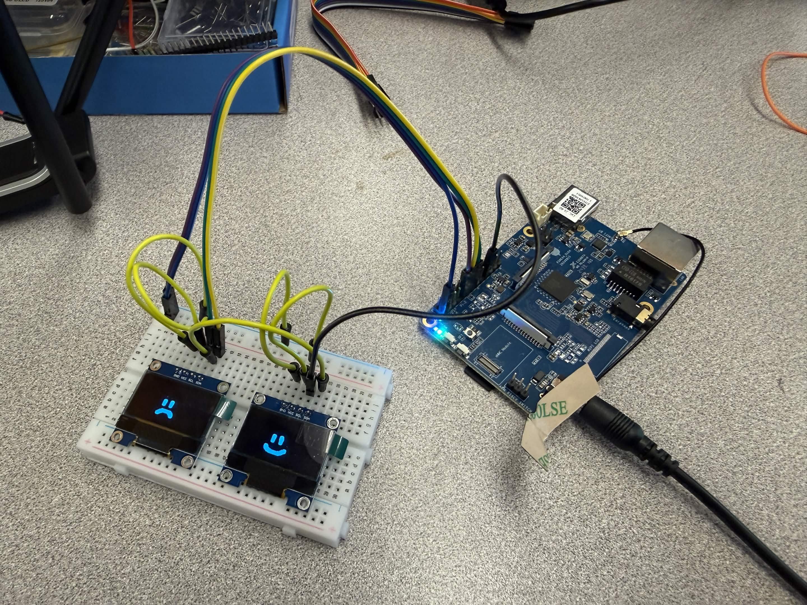

# Lab 3.5

October 12th, 2026

## What did you have working at the start of lab today?

We had an interactive smiley->frowny by sharing pin A28 between Linux and the realtime core so it could be controlled over the command line.

```
sudo gpioset -c gpiochip0 -t 1s,1s 28=0
```

We also had two displays working over the same data bus, but we had to share a clock due to our boards being soldered to address 0x3C. We would have used a screen on 0x3D if we could.

## What did you have working at the end of lab today?

We modified our code to use two different busses.

We chose to use IIC2, which we got the gpio pin numbers from [sophgo-arduino](https://github.com/NatTuck/sophgo-arduino). For future reference:

```
A28 = shared pin between Linux and realtime core
B11 = IIC1_SDA - board pin 11
B12 = IIC1_SCL - board pin 13
B21 = IIC2_SDA - board pin 5
B22 = IIC2_SCL - board pin 3
```

And our image of two displays showing two different images:



To flip the display images, you can gpioset A28. Below should flip between HIGH and LOW every 1s.

```
sudo gpioset -c gpiochip0 -t 1s,1s 28=0
```
